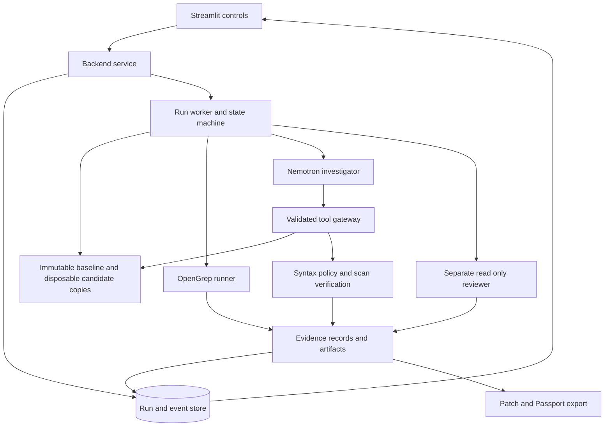

# Veridex backend implementation plan

Prepared 7 November 2026 from PRD v1.0, TRD v1.0, and the current repository.

Build a local Python backend that takes an approved repository through a real scan, model-directed investigation, candidate generation, independent checks, adversarial review, and evidence export. Complete the P0 investigation pipeline first, then the P1 controls and operational checks. Keep the original repository unchanged throughout.

This is an implementation plan. It does not represent completed backend integration. Scope is the full backend described by the supplied requirements, including its Streamlit integration contract; enterprise hosting and the documents' P2 features are separate extensions.

## 1. Requirements and current baseline

Primary sources:

- [PRD v1.0](../../Veridex_PRD_v1.docx), especially sections 6–13.
- [TRD v1.0](../../Veridex_TRD_v1.docx), especially sections 2–9 and 11–14.
- [Current evidence utilities](../agent/evidence.py), [Streamlit application](../frontend/app.py), and [existing tests](../tests/test_evidence.py).

| Area | Current behavior | Required backend work |
| --- | --- | --- |
| Repository input | One bundled Python sample | Approved repository registry, bounded snapshot, isolated workspaces |
| Detection | Three hardcoded findings | Pinned OpenGrep execution, trusted rules, normalized findings |
| Investigation | Scripted activity | Native Nemotron tool calls through a strict tool gateway |
| Candidates | Two hardcoded strings | Model-generated candidates, immutable attempts, controlled application |
| Validation | Real AST and two heuristic policies | Complete check records, rescan comparison, suppression checks |
| Review | Scripted narrative | Separate read-only reviewer request with validated evidence references |
| Evidence | Demo JSON and patch | Versioned live provenance, hashes, error and partial-run exports |
| Controls | Streamlit session variables | Durable jobs, step/run/cancel/reset, revisions, selection |
| Operations | No backend runtime | Configuration validation, worker lifecycle, storage, cleanup, metrics |

Baseline verification: `python3 -m unittest discover -s tests -p 'test_*.py'` from `veridex/` passed all four existing tests. This establishes utility behavior only. No live scanner or model integration was exercised.

Important reuse limits: `evidence_passport()` hardcodes the sample path, reports the original as unchanged without measuring it, and always marks the rescan as not run. Its `mode` argument alone must never enable live claims. `imports()` returns an empty set after a parse failure, so policy evaluation must first require successful parsing. Retain demo behavior in a separate adapter while adding typed live records.

## 2. Scope and implementation decisions

### P0 deliverable

One selected Python finding in an approved local repository can complete this sequence:

1. Create an immutable baseline snapshot and source manifest.
2. Run OpenGrep with trusted, versioned rules and expose actual findings.
3. Let the user select a finding; Nemotron requests actual scoped source reads.
4. Generate a candidate against a known source hash without editing the original.
5. Validate candidate paths, syntax, policy constraints, and scan coverage.
6. Rescan a fresh candidate copy using the baseline rules and configuration.
7. Obtain a separate evidence-grounded reviewer verdict.
8. Export the candidate diff and an honest Evidence Passport, including rejected attempts.

All failure and cancellation paths preserve available evidence. A successful result is a proposal ready for human review; functional correctness remains unverified because target repository code and tests are not executed.

### P1 completion

Support real Run and Step controls, cancellation and Reset, finding inspection and filters, candidate selection from retained attempts, enforced no-import/minimal-diff preferences, revision feedback, and executive aggregates. Reset creates a new run and never erases historical evidence implicitly. Multiple simultaneously generated candidates remain P2.

### Proposed architecture decisions

- Retain Streamlit and implement a framework-independent Python service in the same local application. The TRD does not require a web API. Avoid introducing an HTTP service, Redis, or a distributed queue for the local MVP.
- Run long tasks in a spawned worker process. Streamlit submits commands and polls persisted snapshots/events; rerenders must not restart execution. The model is a remote API dependency; a local GPU is not an MVP prerequisite.
- Use SQLite for durable run metadata and append-only events, plus private per-run artifact directories. Keep source snapshots outside SQLite. Persist state changes and their events in the same transaction.
- Use strict typed schemas, proposed with Pydantic, for tools, commands, records, and exports. Use an HTTP client behind a small NVIDIA adapter. Select exact dependency versions after the compatibility spike, then lock them.
- Support Python source remediation first. Record unsupported files/languages as excluded coverage; do not advertise verified remediation for them.
- Keep demo, deterministic test fixtures, and live runs explicitly separate. An unavailable integration produces an error or inconclusive result, never an automatic demo fallback.

These are proposed implementation choices rather than additional PRD requirements. Public hosting, authentication, organizational roles, and shared workspaces require a separate security design before remote access is enabled.

## 3. Component design and planned files

Paths below are relative to `veridex/`; most files are new.

| Module | Responsibility |
| --- | --- |
| `backend/contracts.py` | Versioned run, finding, candidate, check, review, event, command schemas |
| `backend/config.py` | Validated settings, limits, approved roots, secret loading |
| `backend/service.py` | UI-facing command/query boundary and ownership checks |
| `backend/jobs.py` | Worker spawning, run locking, cancellation, stale-worker recovery |
| `backend/store.py` | SQLite transactions, migrations, artifact references, retention |
| `backend/metrics.py` | Counts, durations, usage, benchmark summaries |
| `workspace/manager.py` | Approved input, safe snapshotting, manifests, disposable copies |
| `workspace/paths.py` | Shared containment, symlink, file-type and size enforcement |
| `scanner/opengrep_runner.py` | Pinned executable, trusted arguments, bounded subprocess, raw results |
| `scanner/normalize.py` | Scanner output to findings, coverage and severity mapping |
| `scanner/patch_verifier.py` | AST, rescan, finding comparison, new-findings detection |
| `scanner/rules/` | Trusted Python rules and a versioned rule manifest |
| `agent/nemotron_client.py` | Provider protocol, native tool calls, timeout and usage handling |
| `agent/tools.py` | Tool registry, schemas, state and scope authorization |
| `agent/orchestrator.py` | Bounded investigator loop and state transitions |
| `agent/candidates.py` | Candidate validation, hashes, fresh-copy application, diff generation |
| `agent/policies.py` | Enforced constraints, scope presets, suppression/deletion detection |
| `agent/reviewer.py` | Distinct read-only review call, verdict and citation validation |
| `agent/prompts/` | Versioned investigator/reviewer prompts |
| `agent/evidence.py` | Reusable pure utilities and versioned live Passport serialization |
| `backend/redaction.py` | Sanitized telemetry and outbound/export content controls |
| `frontend/backend_adapter.py` | Translate UI controls and backend records without execution logic |
| `tests/fixtures/`, `tests/integration/` | Vulnerable examples, recorded responses, integration cases |
| `.github/workflows/backend.yml` | Proposed repository-root CI workflow |

Keep backend imports independent of Streamlit. Use dependency injection for scanner, provider, clock, artifact store, and worker execution so deterministic tests exercise the actual orchestration code.



## 4. Contracts and persistence

| Record | Required content |
| --- | --- |
| Run | `schema_version`, `run_id`, mode, owner/session ID, repository ID, baseline manifest hash, state, pause flag, selected finding, config/policy snapshot, limits, timestamps, outcome/error |
| Finding | TRD fields plus start/end location, raw severity, normalized severity, stable matching fingerprint, source excerpt hash, coverage reference |
| Scan | `scan_id`, baseline/candidate ID, tool version, binary/rule/config hashes, command metadata, exit code, duration, coverage, warnings/errors, raw-output artifact hash |
| Candidate | TRD fields plus attempt number, parent candidate, generation request ID, policy version, candidate content hash, lifecycle status and rejection reasons |
| Check | `check_id`, name, `executed`, `passed: bool or null`, status, details, duration, candidate hash, evidence references, error |
| Review | Verdict, concerns, uncertainty, source/check evidence references, model/prompt versions, request ID, candidate hash |
| Event | TRD fields plus `step_id`, duration, source references, sanitized payload, attempt/candidate ID, error code |
| Steering request | Request ID, text, timestamp, applicable candidate, next attempt, policy snapshot, disposition |

Check status values are `PASS`, `FAIL`, `NOT_RUN`, and `INCONCLUSIVE`. `PASS`/`FAIL` require `executed=true` and a boolean `passed`; incomplete, unavailable, and inconclusive checks have `passed=null`. Preserve tool start/completion/failure separately so a timeout is visible as an attempted execution without a conclusive result. Display `NOT_RUN` as “NOT RUN” where needed.

Use opaque UUIDs for identity. Assign event sequence numbers transactionally per run. Use SHA-256 over exact file/artifact bytes; canonicalize sorted manifests before hashing. Store both scanner-native IDs and application matching fingerprints. A line number is a location, not a stable finding identity.

Suggested tables: `schema_migrations`, `runs`, `findings`, `scans`, `candidates`, `checks`, `reviews`, `events`, `steering_requests`, and `artifacts`. Foreign keys bind evidence to its exact run and candidate. Artifact writes use temporary files plus atomic rename; commit references only after the artifact exists. Detect and clean orphaned temporary files during recovery.

## 5. Workspace and execution boundary

The MVP accepts repositories already registered under operator-approved local roots. The UI submits a repository ID rather than an arbitrary host path. Source code selected for a remote Nemotron investigation is transmitted to the configured provider; make that behavior clear during repository selection and use only approved content.

Implementation tasks:

- Create private run directories outside the original repository; separate immutable baseline, disposable attempt, and artifact paths. Never place the output directory inside the source tree.
- Traverse without following symlinks. Reject symlinks encountered in the accepted tree, special devices, FIFOs, sockets, absolute paths, parent traversal, and paths escaping the approved root. Use descriptor-based/no-follow reads and validate file identity to close check/read races where supported; fail closed when safe handling is unavailable.
- Copy file bytes into newly created files; do not preserve links to the original. Check containment again at every tool read/write and immediately before candidate application. The candidate workspace is private and never writable by repository processes.
- Exclude `.git`, credentials such as `.env` and private keys, virtual environments, dependencies, build output, and binary files using backend-owned rules. Record exclusions and reduced coverage. Never source a repository `.env` or import repository modules.
- Enforce file-count, per-file, total-byte and path-depth limits during traversal. Decode supported Python text explicitly and preserve encoding/newline information; report unsupported encodings.
- Hash the accepted source files at snapshot time and recheck them at run completion, including failure/cancellation where possible. Concurrent source changes produce `original_unchanged=unknown` and an explanation, never a false assertion that Veridex wrote them.
- Launch OpenGrep with `shell=False`, an absolute trusted executable, backend-owned rule/config paths, a constrained cwd and an allowlisted environment without the NVIDIA key. No repository-controlled hooks, config loading, rule downloads, or package installation.
- Never execute target Python, target tests, setup scripts, or generated code. AST parsing and static scanning are the permitted checks. A disposable directory is containment for edits, not a full operating-system sandbox; resource-bound scanner/parser workers and do not claim hostile multi-tenant isolation.

## 6. Scanner and verification semantics

Pin a tested OpenGrep release and binary checksum, plus trusted local rules and their hashes. Prove detection on the bundled SQL injection sample before broadening the rule set. Use a bounded subprocess wrapper, overall/per-rule deadlines where supported, output-size limits, and process-tree termination on cancellation. Verify the exact flags and exit-code behavior against the pinned release.

Normalize real findings, preserving raw data. Define severity mapping explicitly: native `ERROR`, `WARNING`, and `INFO` map to configured application severities; label Critical only when trusted rule metadata defines it. Missing severity is Unknown. Empty results after a scanner failure must never become a clean scan.

Candidate verification proceeds in this order:

1. Require approved paths, original hashes, size limits, and an actual nonempty change.
2. Parse every modified Python file. A failure blocks promotion; dependent policy checks are not reported as passed.
3. Run configured import/diff policies and integrity checks. Detect added suppression comments, deleted vulnerable functions/files, stripped checks, and modified scanner configuration. Do not permit candidates to change rules or ignore files.
4. Create a fresh copy from the baseline and apply the exact validated candidate bytes. Preserve previous attempts separately; retries never stack changes accidentally.
5. Rescan with the same rules, tool, target inventory, and scanner options. Record skipped files, parse errors, timeouts, and truncation. Incomplete relevant coverage makes the comparison inconclusive.
6. Match findings by rule/path and scanner fingerprints where supported, using normalized code/function context and diff line mapping as a fallback. Treat ambiguous matches as inconclusive. Test moved lines, duplicate matches, deleted code, and renamed symbols.
7. Classify the selected finding as `STILL_DETECTED`, `NO_LONGER_DETECTED`, or `INCONCLUSIVE`; separately report new, unchanged, and removed findings across the scanned workspace.

Promotion requires syntax and enabled policies to pass, no integrity/suppression violations, complete relevant scan coverage, the target no longer detected, and no newly introduced findings in the scanned scope. Reviewer results add a separate advisory gate. These checks establish observed evidence, not functional equivalence or guaranteed security.

## 7. Nemotron, tools, review, and budgets

The NVIDIA adapter must first prove that the configured Nemotron model and endpoint return native structured tool calls. Text describing an intended call is insufficient. NVIDIA documents tool execution as the client's responsibility, with support dependent on the selected model/backend. Keep the endpoint/model configurable and fail visibly if unsupported. See [NVIDIA tool-calling documentation](https://docs.nvidia.com/nim/large-language-models/2.1.4/advanced-use-cases/tool-calling-and-mcp.html).

| Tool | Input and authority |
| --- | --- |
| `list_scoped_files` | Bounded prefix/page; return only approved snapshot-relative paths |
| `read_file` | Approved relative path and bounded line range; return source/evidence ID |
| `get_finding` | Existing finding ID from this run; no cross-run lookups |
| `propose_patch` | One approved existing Python file, original hash, replacement text; store candidate only |
| `run_verification` | Candidate ID belonging to this run; backend selects all commands/options |

Validate names and arguments before any effect, reject unknown properties and coercions, authorize by run state, and execute returned calls sequentially. Track native tool-call IDs, reject duplicate conflicting calls, and avoid repeating writes after transport retries. A verification result is bound to the candidate hash and becomes stale immediately after a revision. Require an observed model-requested source read before accepting a proposal for the P0 acceptance case.

Treat source comments, filenames, findings, and tool output as untrusted data. Send only bounded relevant excerpts. Version prompts, preserve instruction precedence, and expose no general shell, arbitrary network, or unrestricted filesystem tool. Record concise model summaries and tool receipts; do not require hidden chain-of-thought text for telemetry.

Reviewer implementation: start a distinct model conversation with the original finding, original/candidate excerpts, exact diff, policy checks, and scan evidence. Use the configured Nemotron model in a separate call; a different model is optional. Do not give it patch tools or the investigator's private narrative. Require `ACCEPT`, `REJECT`, or `UNCERTAIN`, cited evidence IDs, concerns, and uncertainty. Validate that citations exist and resolve to the relevant candidate and source/check locations. Malformed or unsupported citations cannot yield an accepted review. A valid citation does not itself prove the review's reasoning.

The readiness rule is explicit: deterministic gates pass and the review is `ACCEPT` with valid evidence references. A `REJECT` can trigger one bounded retry; `UNCERTAIN`, missing review, or exhausted attempts leaves the result flagged/inconclusive. Retain downloadable rejected proposals with their actual status. Never interpret an advisory acceptance as authorization to apply changes to the original repository.

Suggested initial defaults, to calibrate in the compatibility spike:

| Limit | Proposed default |
| --- | --- |
| Concurrent runs | One active worker per local application |
| Accepted source | 2,000 files, 1 MiB per file, 50 MiB total |
| Generated candidate | One existing Python file, at most 1 MiB |
| Attempts | Two total candidates per investigation, including revisions |
| Model requests / tool calls | Eight / twelve total per run, including review and recovery |
| Context / output | At most 16,000 input tokens and 2,000 output tokens per request, within model capacity |
| Total token budget | 64,000 input plus output tokens per run, reserving capacity for review |
| Provider / scan / total deadline | 60 seconds per request, 120 seconds per scan, 10 minutes active execution |
| Transport retry | At most two transient retries, within request/time/token budgets |
| Retention | 24-hour default for source copies; seven days for local run records/artifacts |

Keep counters durable. Authentication/configuration errors are not retryable; rate limits and transient server failures use bounded backoff. Unknown provider billing after an interrupted request remains unknown. Failed or unknown work is not replayed automatically after a process crash. While paused, stop the active-execution timer but retain an independent workspace expiry.

## 8. State machine and application interface

Use the TRD states, with an explicit proposed `AWAITING_SELECTION` state after a successful baseline scan. Model review is an executed stage, not a decorative progress event.

```text
IDLE -> COPYING -> SCANNING -> AWAITING_SELECTION
     -> INVESTIGATING -> PATCHING -> SYNTAX_CHECK
     -> RESCANNING -> REVIEWING -> READY_FOR_HUMAN_REVIEW
```

Syntax/policy failure returns to `INVESTIGATING` while attempts remain; failed scan comparison or reviewer rejection can also return there. Record the failed candidate before retrying. Policy checks occur between syntax and rescan as explicit events. `FAILED`, `CANCELED`, and `INCONCLUSIVE` are terminal alternatives from applicable stages. A successful zero-finding scan terminates as `READY_FOR_HUMAN_REVIEW` with outcome `NO_FINDINGS` and no candidate; all patch/review checks are NOT RUN and patch download is unavailable. UI copy must distinguish this from a reviewed candidate.

Represent user pause separately from stage. Step advances one bounded orchestration action, then pauses; a scanner/model call remains atomic from the user's perspective. Run resumes automatic actions. Cancellation is cooperative at boundaries and terminates an in-flight scanner; close/timeout an in-flight provider request and discard late results after cancellation. A state-transition table defines every permitted edge and disallows terminal-run mutation.

Proposed Python service interface:

```python
create_run(repository_id, policies, execution_mode, request_id) -> RunSnapshot
select_finding(run_id, finding_id, request_id) -> RunSnapshot
start_run(run_id, request_id) -> RunSnapshot
advance_one_action(run_id, request_id) -> RunSnapshot
cancel_run(run_id, request_id) -> RunSnapshot
request_revision(run_id, candidate_id, feedback, request_id) -> RunSnapshot
select_candidate(run_id, candidate_id, request_id) -> RunSnapshot
get_run(run_id) -> RunSnapshot
list_findings(run_id, filters, cursor) -> FindingPage
list_events(run_id, after_sequence, limit) -> EventPage
export_artifact(run_id, candidate_id, artifact_kind) -> ExportArtifact
reset_run(run_id, request_id) -> RunSnapshot  # cancel, preserve, create new run
```

Commands are validated and idempotent using request IDs; service queries enforce local session/run ownership even though the MVP has no public login system. Repeated button presses cannot spawn duplicate workers. Only candidates with recorded checks may be selected; selecting a rejected attempt does not promote its readiness. Revisions consume remaining attempts; when exhausted, explicitly create a linked new run rather than silently extending budgets. Restarted processes mark abandoned active work inconclusive and offer an explicit new investigation.

Translate the existing scope slider into documented limits: proposed presets 1–5 permit 12/24/48/96/192 added-plus-removed lines in one file. The enabled minimal-diff policy uses the selected limit; when disabled, retain the global byte/file limits. No-new-import policy uses successfully parsed AST imports and documents its top-level-module granularity; relative import additions must be checked as well. Policies remain fixed within an attempt; changes trigger a new attempt and invalidate prior readiness.

## 9. Evidence, privacy, and metrics

Preserve the TRD's existing Passport field names and add `schema_version`, `run_id`, exact model IDs, prompt versions, scanner/rule versions, source/patch/candidate hashes, execution status, error details, per-event timestamps, attempts, and baseline scan evidence. The selected candidate's top-level fields must refer to that candidate only; other attempts appear in history. Export partial Passports for canceled and failed runs, with absent checks explicitly not run or inconclusive.

Both JSON and patch downloads include timestamps, source paths, check statuses and limitations as required by PRD §11. Give `.patch` exports a patch-compatible metadata preamble and unchanged unified-diff hunks; test applicability against trusted fixture copies without executing their code. Define `patch_hash` over the exact downloaded bytes and a separate `diff_hash` over the hunks to avoid self-referential metadata hashes. The Passport records both.

Separate telemetry from requested artifacts. Logs contain sanitized bounded summaries, IDs and hashes, without API keys, authorization headers, full source, raw prompts, or secrets embedded in scanner output. Source-bearing diffs/Passports are generated only through explicit export controls. Preflight outbound excerpts for known secret patterns; redact context or block the request if the relevant code cannot be shared safely. Redaction is best effort, so approved repository selection remains necessary. Never redact stored candidate bytes silently: a redacted patch must not be presented as an applyable original diff.

Run metadata can outlive source copies, but historical exports are available only while required artifacts remain retained. Mark expired artifacts clearly. Cleanup cannot remove active work; explicit deletion and scheduled retention remove only backend-owned directories. Keep source-bearing state private, ignored by Git, and outside application logs.

Calculate PRD metrics from recorded events: completion and finding-clearance rates, AST pass rate, curated unsafe-candidate rejection rate, human interventions, median investigation duration, tool failures, and token usage. Define denominators and separate demo, recorded-test, live, canceled, and inconclusive runs. Cost is unknown unless configured pricing and provider usage are available; do not fabricate it. Executive counts derive from the selected actual scan/candidate rather than constants.

## 10. Sequenced implementation backlog

Estimates are engineering days for one developer, including focused tests and review. They assume working NVIDIA credentials and accessible scanner binaries. Total: approximately 17–26 engineering days; throughput depends on integration findings. The hackathon subset is a narrower demonstration milestone, not completion of the full plan.

| Milestone | Dependencies | Estimate | Reviewable exit condition |
| --- | --- | --- | --- |
| M0 Contracts and integration spike | None | 1–2 days | Native Nemotron tool-call round trip and real OpenGrep sample finding; contract/settings decisions recorded |
| M1 Workspace and provenance | M0 contracts | 2–3 days | Isolated snapshot and manifest; containment tests pass; original preservation measured |
| M2 Scanner and normalization | M0, M1 | 2–3 days | Real baseline scan, typed findings/coverage, pinned rules, timeout/error handling |
| M3 Candidate verification and policies | M1, M2 | 3–4 days | Fresh-copy patching, AST/policy gates, reliable before/after comparison, unsafe fixture flagged |
| M4 Investigator and tool gateway | M0–M3 | 3–4 days | Real model-requested reads and proposals; schema/state enforcement and bounded retries |
| M5 Review and Passport | M3, M4 | 2–3 days | Independent cited review; complete and partial evidence exports validated |
| M6 Jobs and Streamlit integration | M1–M5 | 2–4 days | Durable controls, real telemetry/findings/summary, cancellation and revision behavior |
| M7 Release validation and operations | M0–M6 | 2–3 days | CI and benchmark gates, live smoke, clean-machine runbook and failure rehearsal |

### M0 Contracts and integration spike

- Add settings/contracts and choose/test the supported Python version, proposed Python 3.11+.
- Extend `.env.example` with endpoint, model, scanner path, rule path, data root and limits; keep keys out of files committed to Git.
- Verify configured endpoint/model tool calling using a harmless read-only fixture tool, not merely plain text completion. Record sanitized capability evidence.
- Verify the scanner detects the existing SQL sample and capture real JSON/error/coverage fixtures. Confirm rule licensing before bundling external rules.
- Lock compatible dependencies and define offline versus live test entry points. Provider capability failure blocks model integration; do not substitute simulated success.

### M1 Workspace and provenance

- Implement approved repository IDs, source exclusions, no-follow copy, manifest hashes and read-only baseline.
- Implement per-attempt copies, bounded reads, shared path authorization and cleanup ownership.
- Add atomic artifact writes and initial storage migrations; establish run/event transactions for all later milestones.
- Gate on traversal, absolute paths, symlink/race cases, special files, byte limits, encoding handling and unchanged originals.

### M2 Scanner and normalization

- Implement trusted executable/config construction, environment isolation, bounded output, process cleanup and JSON validation.
- Record exact tool/rules/config versions and scan inventory; normalize findings without losing raw evidence.
- Gate on detection, true zero-findings, duplicate matches, missing executable, timeout, malformed/truncated JSON, partial coverage and scanner errors.

### M3 Candidate verification and policies

- Add immutable candidate records with original hash checks and backend-generated diffs; accept replacement text instead of executing model-authored patch commands.
- Reuse AST/diff helpers where appropriate; fix invalid-AST policy semantics and relative-import handling for live checks.
- Implement scope limits, suppression and deletion detection, same-configuration rescans, and matching across changed lines.
- Gate on a safe SQL candidate passing, the existing unsafe candidate remaining detected, and suppression-only/deletion candidates blocked or explicitly flagged.

### M4 Investigator and tool gateway

- Implement native call/result message flow, strict argument validation, state authorization and run-scoped evidence IDs.
- Connect the real scanner findings and source excerpts; validate proposed candidates before any workspace mutation.
- Implement durable request/tool/token/deadline counters, transient retry policy, safe source boundaries and structured errors.
- Gate on deterministic recorded trajectories plus a live model-requested file read and real proposed diff.

### M5 Review and Passport

- Implement the isolated reviewer prompt, structured verdict validation and evidence reference resolution.
- Centralize readiness decisions so UI, export and metrics use the same result.
- Extend evidence exports with actual scan/check/review records, immutable attempts and integrity hashes; preserve demo adapter compatibility.
- Gate on accepted/rejected/uncertain/malformed reviews, stale candidate evidence, incomplete runs, secret-safe telemetry and hash-consistent exports.

### M6 Jobs and Streamlit integration

- Complete the service/job manager with worker locks, polling, idempotent commands, cancellation, stale-worker recovery and retention.
- Replace hardcoded live findings, candidates, review text, events and executive counts with backend records. Keep demo constants inside the explicit demo path.
- Wire controls to actual commands and evidence status. Feedback must create a recorded revision action; preferences must affect measured policies.
- Gate on repeated rerenders/clicks, Step versus Run, cancel during scan/model work, reset, candidate switching, feedback, no findings, missing keys and unavailable scanner.
- Retain the PRD's browser checks for theme, empty/error rendering and reduced motion as UI acceptance dependencies; they are outside pure backend unit tests.

### M7 Release validation and operations

- Add repository CI for deterministic tests and real pinned-scanner integration. Provider tests run separately with secrets and never silently pass when unconfigured.
- Add a fixed labeled benchmark and report observed counts/denominators rather than a claimed general accuracy score.
- Verify installation from the lockfile, local startup, configuration errors, health diagnostics, schema migration, crash recovery and retention cleanup.
- Complete a runbook covering key setup, approved repositories, provider data transmission, execution limits, evidence interpretation, troubleshooting, backup/expiry and demo rehearsal.

Critical path: `M0 → M1 → M2 → M3 → M4 → M5 → M6 → M7`. Storage/job scaffolding starts in M1; control wiring finishes in M6. Suggested ownership if staffed: backend lead for contracts/orchestration; scanner/workspace engineer; verification/evidence engineer; frontend integrator for service wiring and browser acceptance. This is an implementation staffing suggestion, not a requirement to use autonomous agents.

## 11. Test and release acceptance matrix

| Requirement | Acceptance evidence |
| --- | --- |
| PRD §6 and §11 real investigation | Real sample scan, native model read receipt, generated diff, AST result, real rescan and export |
| PRD §7 truthful evidence | Schema-valid complete/partial Passports; no PASS without execution; candidate/source hashes resolve |
| PRD §8 skeptical review | Separate request, cited source/check references, retained rejection and bounded retry |
| PRD §9 human control | Run/Step/Reset/cancel/feedback/policies/candidate selection exercise real service behavior |
| PRD §10 executive summary | Aggregates match persisted scans/candidates, including empty/error states |
| PRD §11 original preservation | Before/after manifests and independent test checks show no writes to the original |
| TRD §5 tool safety | Unknown tools/extra arguments/coercions/cross-run IDs rejected; no shell tool exists |
| TRD §6 scanner correctness | Timeouts, parse errors, changed line locations, duplicate findings and partial scans classified correctly |
| TRD §7 containment | Traversal, absolute paths, symlinks, special files and oversized inputs rejected |
| TRD §8 policy integrity | Invalid AST cannot pass imports policy; suppressed/deleted findings cannot masquerade as repairs |
| TRD §9 privacy | Keys and secret patterns absent from logs; source exports explicit; incomplete runs retain limitations |
| TRD §12 reproducibility | Offline recorded-model suite, real-scanner integration suite, separate live smoke suite |

Required fixture set: vulnerable SQLite concatenation, safe parameterized SQL, unsafe formatted SQL, suppression-only patch, deleted-function patch, syntax failure, import additions including relative imports, prompt-injection comments, shifted/duplicate findings, a newly introduced finding, no findings, malformed provider calls, invalid review citations, scanner failure/timeout and cancellation. Tests run trusted fixture assertions; the application never executes submitted repository code.

Release gates:

1. All deterministic contract, containment, policy, lifecycle and evidence tests pass.
2. Pinned real-scanner integration detects the vulnerable baseline and measures the safe candidate correctly.
3. Every curated unsafe case is rejected or explicitly flagged; none appears ready for human review.
4. A separately executed live Nemotron/OpenGrep smoke test satisfies the full P0 trace. Missing credentials mark it not run and prevent a live-ready release claim.
5. Source manifests remain unchanged in success, rejection, failure, cancellation and retry scenarios.
6. Streamlit consumes backend records and displays no scripted live events or fake waiting periods.
7. Clean-machine setup and failure recovery can be reproduced from the runbook.

## 12. Delivery boundaries and later extensions

The first defensible demonstration ends after M5 with a headless or thin-UI real Python investigation and valid exports; M6–M7 complete the integrated P0/P1 release. If hackathon time is shorter than the estimates, demonstrate the bundled sample with fixed trusted rules and the two required policies while clearly stating which controls remain unfinished. Preserve isolation and evidence gates when reducing scope.

The PRD explicitly classifies dynamic YAML policies, investigation graphs, simultaneously generated patch alternatives, and repository/PR integrations as P2. Plan those after P0/P1 release: schema-validate YAML into approved constraints; derive graphs from recorded evidence edges; assign isolated workspaces and evidence to each alternative; and add scoped repository credentials plus explicit PR publication controls. These features are not prerequisites for this release.

Remote hosting is a separate project: introduce an authenticated API, per-user authorization/storage, hardened isolated scanner workers, egress policy, quotas, encrypted retention and deployment operations before exposing local-repository capabilities over a network. Do not infer enterprise readiness from the local implementation.

Unresolved implementation inputs are the authorized NVIDIA endpoint/model, actual tool-call capability and quota, exact tested OpenGrep release/rule bundle, and approved repository roots. M0 resolves or validates these; no further product decision is needed to begin the local contracts and safety work.

External technical references, checked during planning: [NVIDIA tool calling](https://docs.nvidia.com/nim/large-language-models/2.1.4/advanced-use-cases/tool-calling-and-mcp.html), [OpenGrep project](https://github.com/opengrep/opengrep/), and [OpenGrep output and CLI changes](https://github.com/opengrep/opengrep/blob/main/OPENGREP.md). OpenGrep documents fingerprints in JSON and suppression/ignore controls; use those features as inputs to a tested comparison and coverage policy rather than assuming line-number equality is sufficient.
